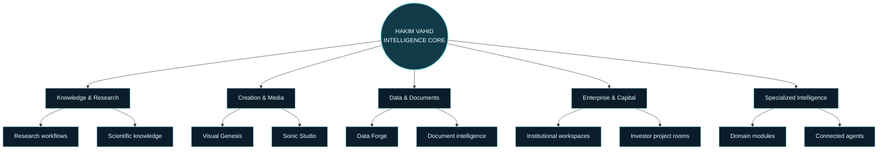
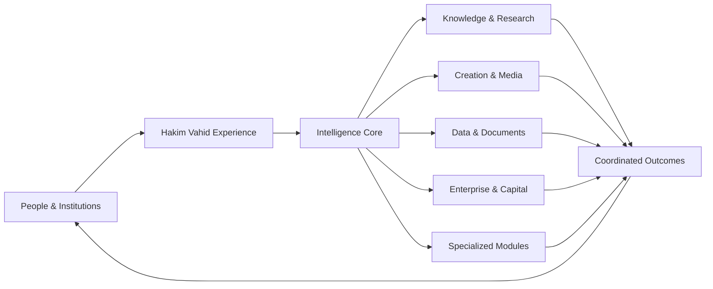

# HAKIM VAHID
### THE INTELLIGENCE BEYOND TOMORROW

**A connected intelligence ecosystem — envisioned, architected and assembled puzzle by puzzle.**

[Explore the Flight Deck](./Hakim_Vahid_Orbital_Glass_Experience.html) · [Project Roadmap](#the-master-roadmap) · [Architecture](#the-ecosystem-architecture) · [Partnerships](#strategic-partnerships)

**Architect & Founder: Vahid Nezamivand Chegane**

---

## The vision

**Hakim Vahid** is a long-horizon vision for a unified intelligence ecosystem: one coherent environment in which people can research, reason, create, analyze, learn, coordinate and build.

The ambition is not to gather disconnected tools under one label. It is to shape a connected platform in which specialized capabilities can work together through a shared experience, a common design language and an evolving intelligence architecture.

The project is being built **piece by piece, module by module**. Each component is a piece of a much larger picture. As the pieces are designed, developed and connected, they form an expanding platform intended to bring knowledge, creativity, science, enterprise and human decision-making into one coordinated environment.

> **One vision. Many specialized capabilities. A single connected intelligence universe.**

## The architect & founder

**Vahid Nezamivand Chegane** is the **Architect and Founder of Hakim Vahid**.

The founding vision is to design an integrated intelligence ecosystem from the system level: defining its identity, experience, modular structure, strategic direction and the relationships between its future capabilities.

The role of the architect is to see the whole picture while shaping each individual piece — ensuring that every module has a purpose, every connection contributes to the larger system, and the platform develops according to a coherent long-term direction.

## The experience

The Hakim Vahid experience takes inspiration from advanced mission-control environments, orbital systems and next-generation glass interfaces.

Its visual language is built around:

- **Orbital command interface** — a central intelligence core surrounded by specialized capability modules.
- **Glass-inspired surfaces** — layered panels, translucent depth and luminous edges.
- **Circular navigation** — an intuitive visual metaphor for connected capabilities.
- **Mission-oriented information design** — clear routes through discovery, exploration, evaluation and collaboration.
- **A unified visual identity** — deep space tones, luminous aqua, refined gradients and purposeful motion.

The interface is designed to make a complex ecosystem feel navigable: users can see the central vision, discover its modules and understand how the pieces relate to one another.

---

## The ecosystem architecture

Hakim Vahid is conceived as a modular ecosystem. Each major domain can evolve as a dedicated workstream while remaining connected to the wider platform vision.

### 1. Intelligence Core

The central layer of the experience — the place where people interact with connected intelligence capabilities.

- Multimodal conversations and reasoning experiences
- Research, writing and structured problem-solving
- Coding and technical assistance
- Multilingual interaction
- A unified entry point to specialized tools

### 2. Knowledge & Research

A dedicated knowledge environment for people who work with complex information.

- Research discovery and literature workflows
- Scientific writing and manuscript support
- Source-oriented knowledge organization
- Learning, explanation and knowledge synthesis
- Collaborative research spaces

### 3. Creation & Media

A creative environment connecting ideas to expressive outputs.

- **Visual Genesis:** image concepts, visual ideation, storyboards and design workflows
- **Sonic Studio:** original sound concepts, audio workflows and creative production
- Creative briefs, presentation concepts and visual storytelling
- Future media-tool integrations

### 4. Data & Documents

A productivity and analysis layer for information-rich work.

- PDF and document understanding
- Spreadsheet analysis and formula assistance
- Data interpretation and visualization
- Reports, presentations and structured outputs
- Connected document workflows

### 5. Enterprise & Capital

A strategic workspace for organizations, founders and capital partners.

- Project rooms and structured opportunity briefs
- Strategic planning and institutional knowledge
- Due-diligence workspaces and review checklists
- Milestone, impact and execution frameworks
- Partnership and enterprise collaboration pathways

### 6. Specialized Intelligence

A growing family of domain-oriented modules designed to extend the ecosystem into important areas of human activity.

| Module | Long-term direction |
|---|---|
| **Cyber Shield** | Security awareness, risk workflows and incident coordination |
| **Digital Twin** | Scenario modelling for cities, buildings and infrastructure |
| **Health Intelligence** | Organized health information and health-workflow support |
| **Financial Intelligence** | Financial research, scenario analysis and risk context |
| **Earth Intelligence** | Environmental observation and climate-related insights |
| **Autonomous Agents** | Permissioned multi-step workflows and coordination |
| **Knowledge Hub** | Learning, research and structured knowledge spaces |
| **Energy & Resilience** | Energy systems and critical-infrastructure insights |
| **Travel & Mobility** | Journey planning and mobility-service connections |

---

## The master roadmap

The roadmap is a connected construction journey. It is designed to move from a coherent foundation toward an integrated ecosystem, with each stage adding a new set of carefully connected pieces.

### Phase 01 — Foundation & identity

Establish the central experience and the design language that gives the ecosystem its recognizable identity.

- Hakim Vahid identity and product narrative
- Orbital Flight Deck and navigation experience
- Core interface patterns and design system
- Initial capability map and modular structure
- Project documentation and development framework

### Phase 02 — Intelligence experience

Bring the core intelligence experience and everyday workflows together.

- Conversation and reasoning workflows
- Research and knowledge experiences
- Document and PDF workflows
- Data and spreadsheet experiences
- Creative and visual workflows
- Multilingual experience development

### Phase 03 — Specialized modules

Expand the platform through focused modules, each with its own domain logic and development path.

- Scientific and research intelligence
- Data Forge and document intelligence
- Visual Genesis and Sonic Studio
- Enterprise and capital workspaces
- Domain-oriented intelligence modules

### Phase 04 — Connected ecosystem

Connect modules, people and institutional workflows into a coordinated environment.

- Shared workspaces and collaboration
- Connected tools and authorized data sources
- Permissioned agent workflows
- Organization-oriented experiences
- Governance, trust and operational frameworks

### Phase 05 — Global intelligence vision

Develop the long-term ecosystem vision through partnerships, domain expertise and carefully selected real-world applications.

- Research and university collaboration
- Enterprise and institutional partnerships
- Infrastructure and digital-twin pathways
- Global knowledge and data ecosystems
- Strategic deployment opportunities

> **The roadmap is intentionally modular:** each phase contributes a meaningful piece, while the overall architecture keeps the destination in view.

## How the pieces connect

The ecosystem is intended to make the journey between disciplines feel natural. A researcher may move from literature discovery to data interpretation and manuscript preparation. A founder may move from strategic research to project documentation and an investor briefing. An institution may connect specialist knowledge, teams and workflows within a shared environment.

The central idea is **continuity**: capabilities should complement one another rather than exist as isolated destinations.

## Trust, human direction & responsible design

Trust and human direction are foundational principles of the Hakim Vahid vision.

The intended product experience places emphasis on:

- Clear user control and understandable workflows
- Privacy-conscious product design
- Permission-aware integrations and agent actions
- Traceable information and source context where relevant
- Responsible use of specialized domain capabilities
- Human review for consequential decisions

The goal is to make advanced intelligence more accessible while keeping people meaningfully involved in the decisions that matter.

## Strategic partnerships

Hakim Vahid is envisioned as a platform that can grow through collaboration with people and organizations bringing deep expertise, technology, research capacity and real-world insight.

Potential collaboration pathways include:

- Universities, laboratories and research groups
- AI and technology developers
- Enterprise and institutional partners
- Scientific and professional communities
- Strategic investors and long-term capital partners
- Domain experts and implementation partners

Partnership discussions can focus on a specific module, a shared research direction, a technology integration or a broader ecosystem opportunity.

## The guiding principles

| Principle | Meaning |
|---|---|
| **Unified by design** | A coherent experience across a diverse set of capabilities |
| **Modular by architecture** | Each piece can be developed with a clear purpose and pathway |
| **Human-directed** | Technology supports human understanding, creativity and decisions |
| **Research-oriented** | Knowledge, evidence and specialist insight matter |
| **Built for connection** | Modules are designed to contribute to a wider ecosystem |
| **Long-term perspective** | Each milestone is part of a larger, carefully assembled vision |

## Project identity

- **Project:** Hakim Vahid
- **Positioning:** Connected Intelligence Ecosystem
- **Architect & Founder:** Vahid Nezamivand Chegane
- **Core metaphor:** An expanding intelligence universe, assembled puzzle by puzzle
- **Experience identity:** Orbital Flight Deck / Glass Interface
- **Development philosophy:** Modular construction, coherent architecture and progressive integration

## Explore the project

- **Flight Deck:** [Open the Hakim Vahid experience](./Hakim_Vahid_Orbital_Glass_Experience.html)
- **Master roadmap:** [View the roadmap graphic](assets/hakim-vahid-roadmap.svg)
- **Orbital identity:** [View the animated orbital core](assets/hakim-vahid-orbit.gif)
- **Project visual:** [View the hero artwork](assets/hakim-vahid-hero.svg)

---

### THE FUTURE IS NOT BUILT IN ONE STEP.
## IT IS ASSEMBLED — PIECE BY PIECE.

**HAKIM VAHID**  
*Architected by Vahid Nezamivand Chegane*

One vision. A universe of connected possibilities.

